# Hastane Mikroservis Sistemi

ASP.NET Core 10 ile yazılmış, 15 mikroservis + API Gateway + MVC arayüzden oluşan bir hastane yönetim, randevu ve
eczane/mağaza sistemi. Hasta doktor arar, boş saatten randevu alır, öder, randevu günü sıraya girip çağrı ekranından
numarasını izler, reçetesini görür, mağazadan ürün sipariş eder; doktor randevularını, sırasını, hastalarını ve çalışma
saatlerini yönetir; yönetici her şeyi grafikli bir panelden izler, reçete karşılar, ilaç ve ürün stoğunu yönetir.

> *An educational, open-source hospital management system built with .NET 10 microservices (MongoDB, SQL Server, MariaDB,
> Redis, Elasticsearch, RabbitMQ, Kafka, SignalR, Ocelot, JWT RS256, MVC). Turkish UI and docs. Inspired by Murat Yücedağ's
> Udemy course; code written from scratch.*

 
 

## Teknoloji yığını

| Katman | Kullanılanlar |
|---|---|
| **Backend** | C# · .NET 10 · ASP.NET Core Web API · EF Core 10 · Mapster |
| **Arayüz** | ASP.NET Core MVC (Razor) · Bootstrap 5 · Bootstrap Icons · Chart.js · SignalR JS istemcisi |
| **API Gateway** | Ocelot (HTTP + WebSocket yönlendirme) |
| **Veritabanları** | SQL Server 2022 · MongoDB 8 · MariaDB 11.4 · Redis 7.4 (önbellek + sepet) · Elasticsearch 8.15 (arama) |
| **Mesajlaşma** | RabbitMQ 3.13 + MassTransit 8 (transactional outbox) · Apache Kafka 3.8 (Confluent.Kafka) |
| **Gerçek zamanlı** | SignalR (çağrı ekranı) |
| **Mimari desenler** | Mikroservis · Database-per-service · CQRS + MediatR 12 · Event-driven · Outbox · Idempotency |
| **Güvenlik** | JWT RS256 · rol + sahiplik bazlı yetki · HttpOnly şifreli çerez · antiforgery · servisler arası iç anahtar |
| **Test** | xUnit v3 · Microsoft.Testing.Platform · Testcontainers (gerçek veritabanı konteynerleri) · 2.837 test |
| **DevOps** | Docker · Docker Compose · çok aşamalı Dockerfile · Caddy (HTTPS) · Seq (log) · MailHog (e-posta) |

## Ekran görüntüleri

<table>
  <tr>
    <td width="50%">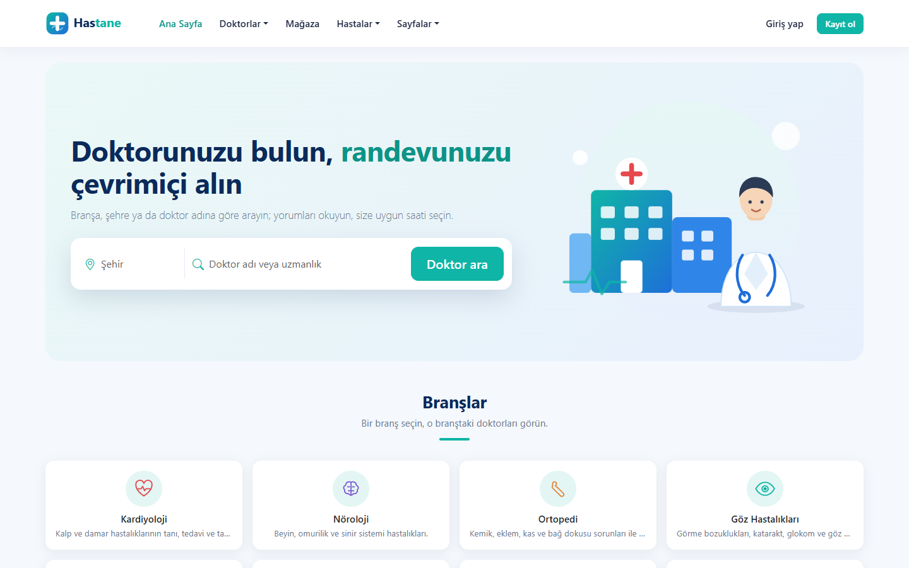<br><b>Ana sayfa:</b> şehir ve doktor/uzmanlık araması, branşlar</td>
    <td width="50%">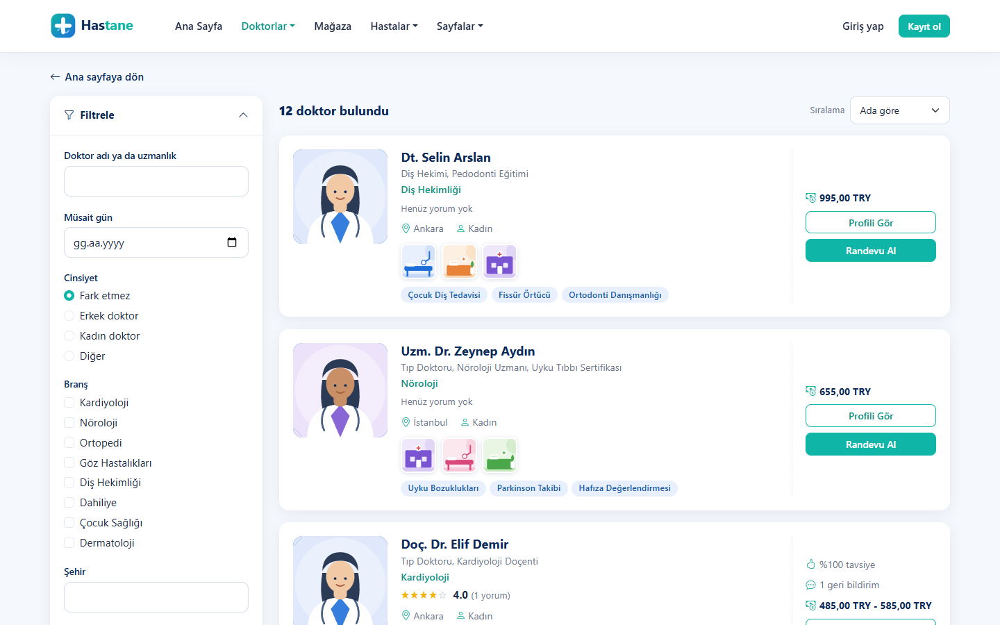<br><b>Doktor arama:</b> açılır-kapanır filtre paneli; "kardyoloji" gibi yazım hatalarını Elasticsearch tolere eder</td>
  </tr>
  <tr>
    <td>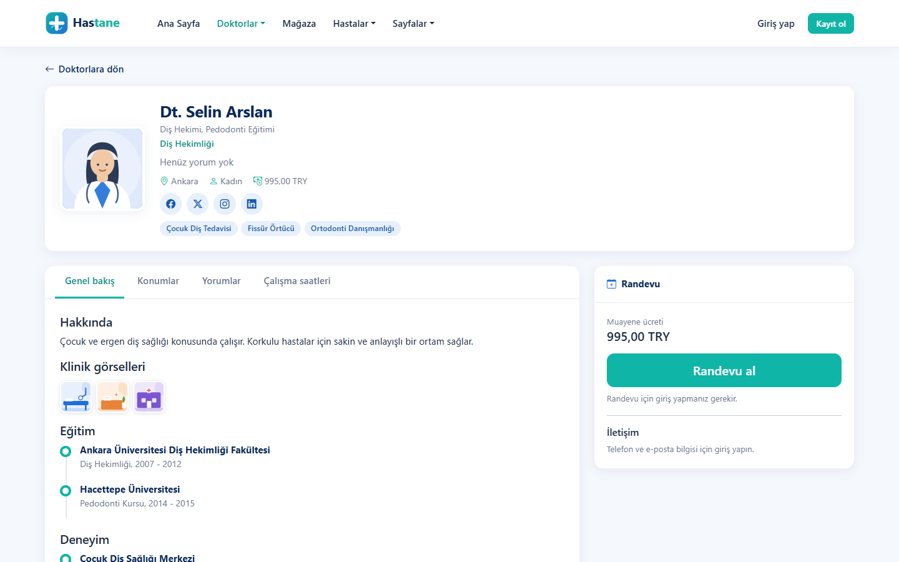<br><b>Doktor profili:</b> eğitim, deneyim, klinik görselleri, yorumlar, çalışma saatleri</td>
    <td>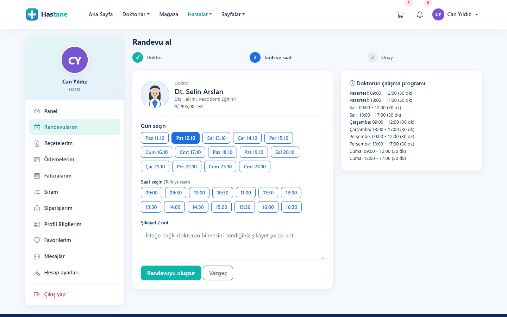<br><b>Randevu alma:</b> gün ve boş saat seçimi (doktorun programı − dolu randevular)</td>
  </tr>
  <tr>
    <td>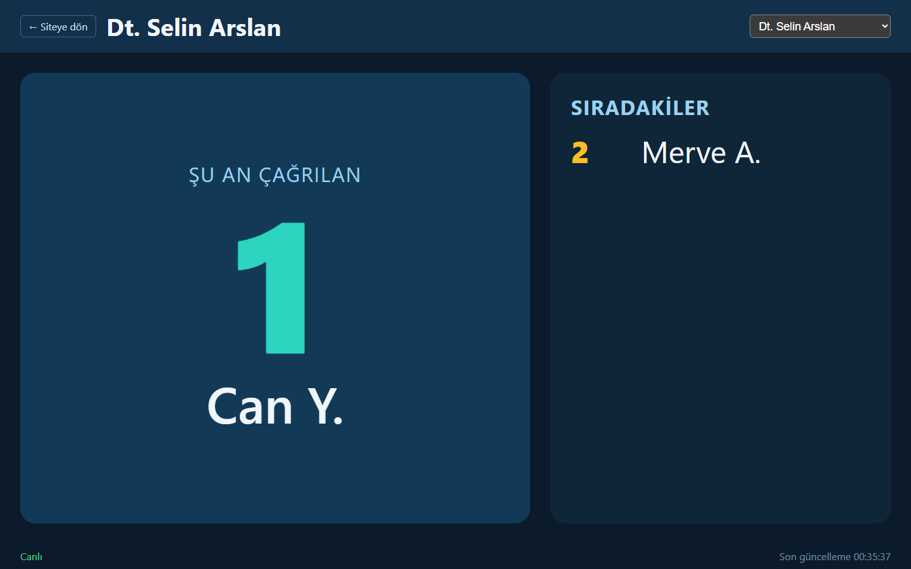<br><b>Bekleme salonu çağrı ekranı:</b> SignalR ile canlı, girişsiz; ad maskeli</td>
    <td>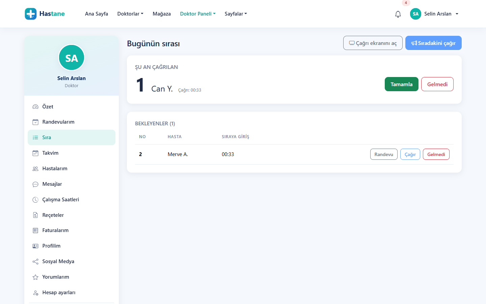<br><b>Doktor: günün sırası</b> (sıradakini çağır, tamamlandı, gelmedi)</td>
  </tr>
  <tr>
    <td>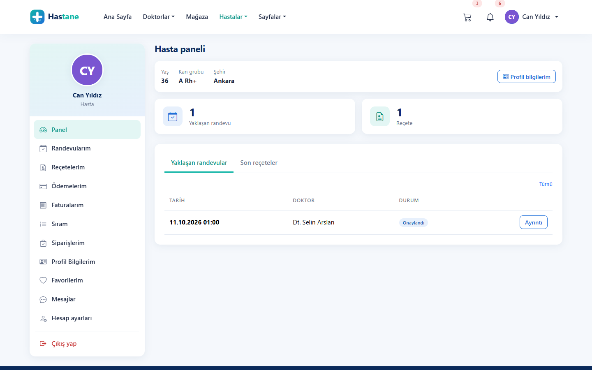<br><b>Hasta paneli:</b> randevular, reçeteler, ödemeler, sıra, siparişler</td>
    <td>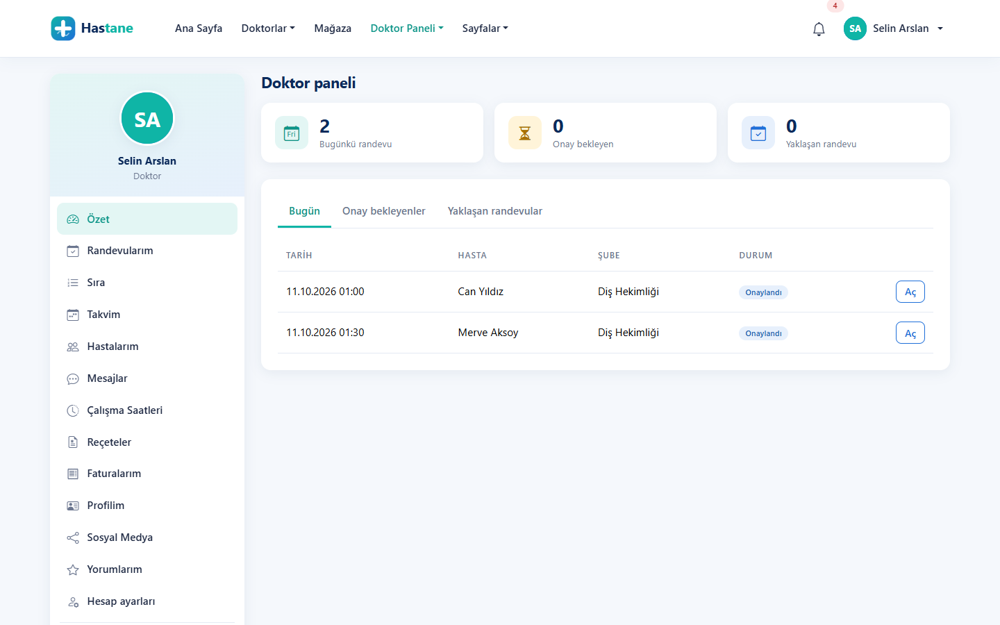<br><b>Doktor paneli:</b> bugünkü, onay bekleyen ve yaklaşan randevular</td>
  </tr>
  <tr>
    <td>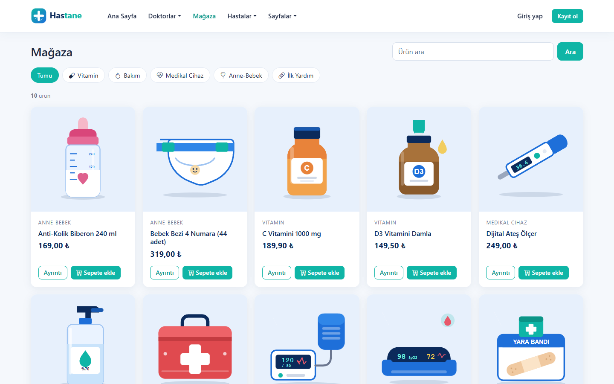<br><b>Mağaza:</b> kategoriler ve arama (ürün önbelleği Redis'te)</td>
    <td>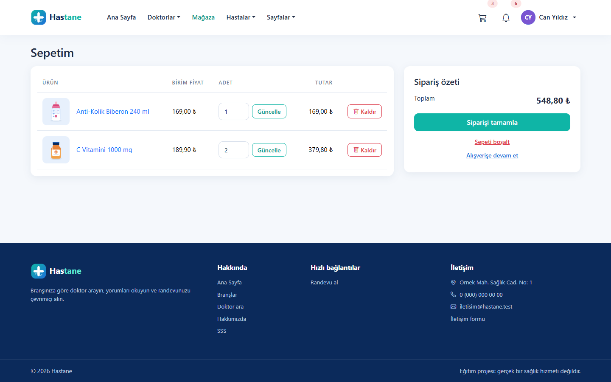<br><b>Sepet:</b> Redis'te 7 gün saklanır; fiyat siparişte sunucuda yeniden okunur</td>
  </tr>
  <tr>
    <td>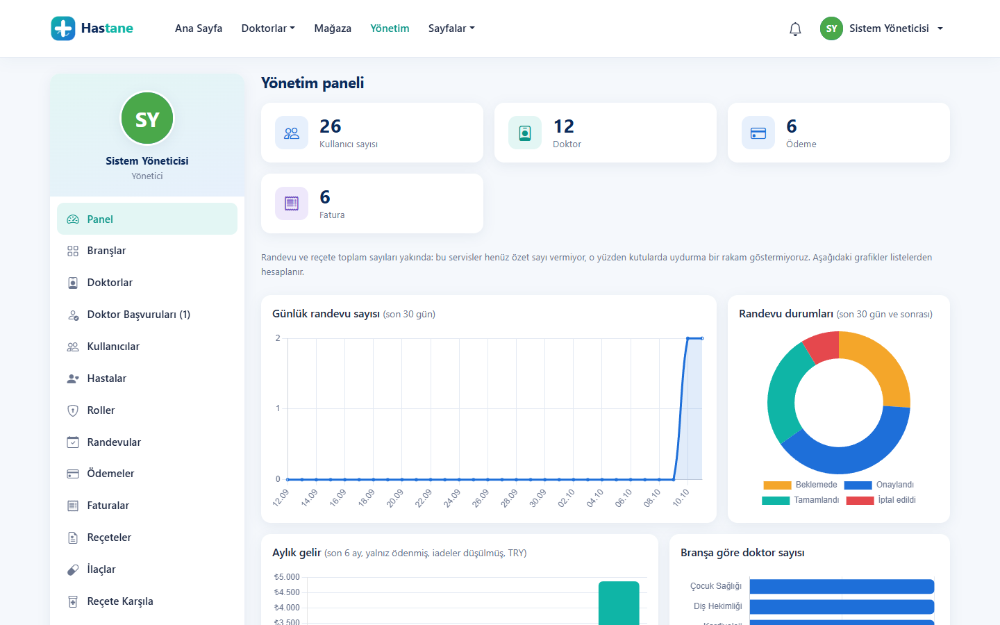<br><b>Yönetim paneli:</b> grafikler (randevular, durumlar, gelir, branşlar)</td>
    <td>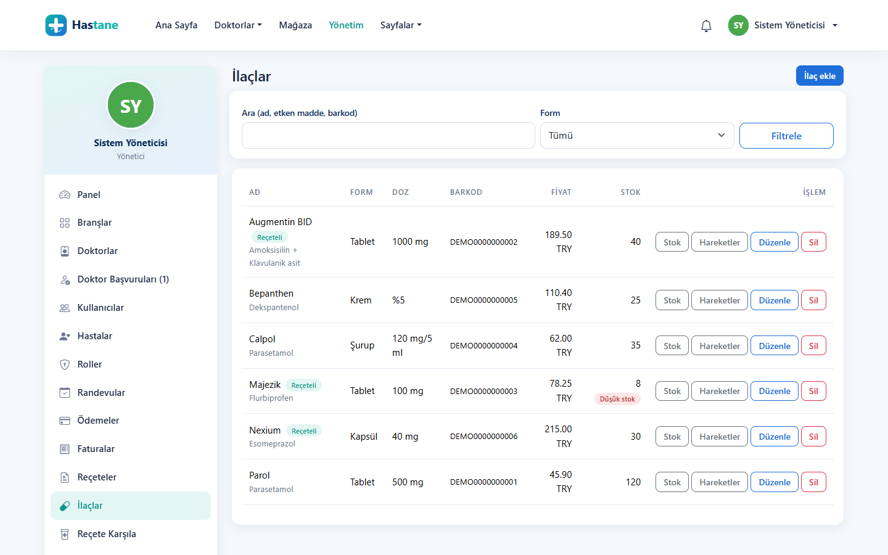<br><b>Eczane:</b> ilaç kataloğu, stok hareketleri, düşük stok uyarısı (CQRS + MediatR)</td>
  </tr>
  <tr>
    <td>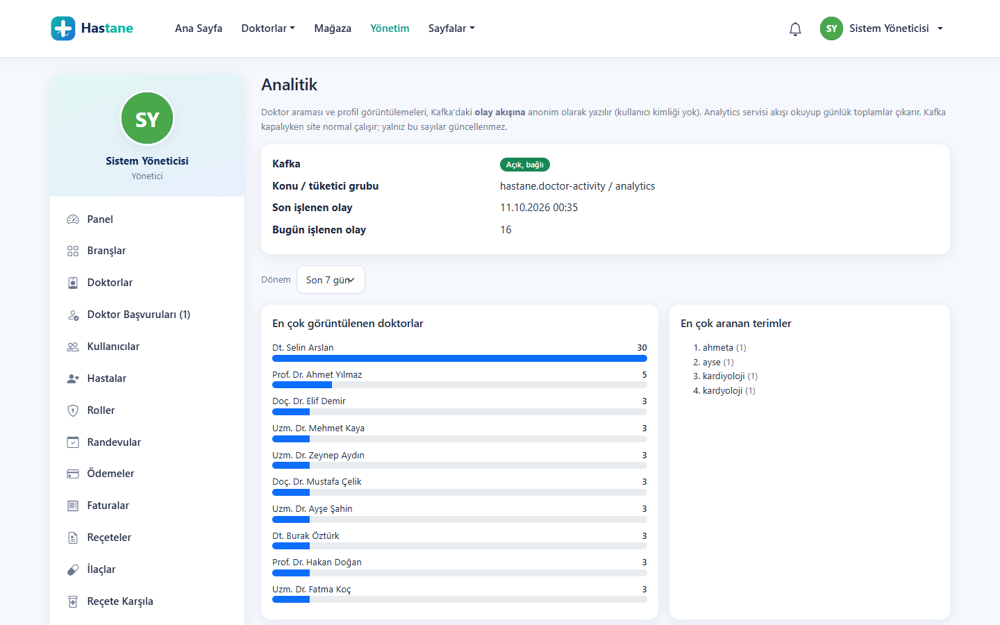<br><b>Analitik:</b> Kafka akışından en çok görüntülenen doktorlar ve aranan terimler</td>
    <td align="center">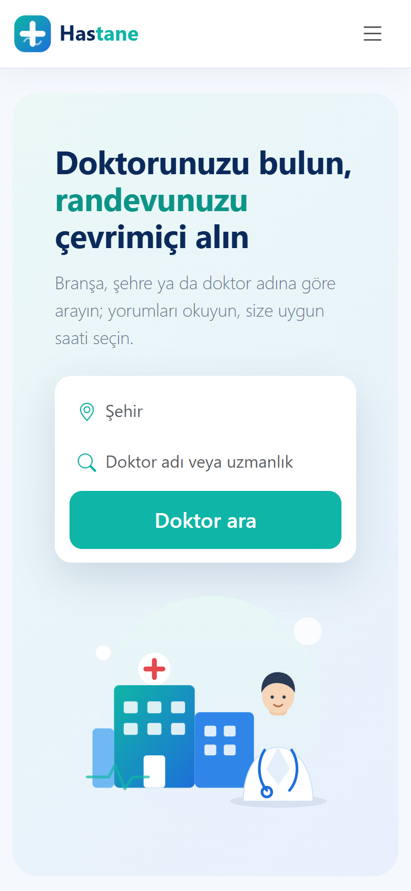<br><b>Mobil görünüm</b></td>
  </tr>
</table>

Görüntüler örnek veriyle (`tools/Hastane.DevSeed`) alındı; kişiler ve kurumlar kurgusaldır.

---

## Bu proje ne, kurstan farkı ne?

Proje, **Murat Yücedağ**'ın Udemy kursu
[**ASP.NET Core Mikroservis Mimarisi | Doccure Hastane Sistemi**](https://www.udemy.com/course/aspnet-core-mikroservis-mimarisi-doccure-hastane-sistemi/)
izlenerek başladı. Kurs bu depoda **müfredat** olarak kullanıldı (konu sırası ve kapsam); kod kursun kodunun kopyası değildir,
sıfırdan yazıldı. Kursun kaynak kodu bu depoda yoktur. Kursu almak isteyenler için yukarıdaki bağlantı resmi sayfadır;
emeği için hocaya teşekkürler.

Kursta olmayan ya da kurstan farklı yapılan başlıca işler:

| Alan | Bu depoda yapılan |
|---|---|
| **Test** | Kursta test yok. Burada 18 test projesi var (sayılar [Testler](#testler) tablosunda): birim testleri + gerçek MongoDB / SQL Server / MariaDB / Redis konteynerleriyle entegrasyon testleri (Testcontainers), her servise yetki tablosu testleri. |
| **Kimlik** | JWT **RS256** (açık/özel anahtar; yalnız Identity imzalar, diğer servisler yalnız doğrular), rol + sahiplik bazlı yetki, `alg:none` ve HS256 "alg confusion" saldırı testleri, hesap kilidi, şifremi unuttum (e-postayla), doktor başvurusu + yönetici onayı, profil fotoğrafı (içerik imzasıyla doğrulama). |
| **Ödeme** | Yeni **Payment** servisi: sahte ödeme sağlayıcısı, idempotency anahtarı (çift tıklamada iki kez çekmez), telafi, iade; tutar sunucuda doktorun ücretinden doğrulanır, kart verisi saklanmaz. |
| **Randevu** | Doktorun haftalık programından **boş saat hesabı**, program dışı saate ve aynı dakikaya çift randevu engeli (iki katmanlı savunma), İstanbul saat dilimi. |
| **Olaylar** | Kursta servisler arası iletişim tamamen senkron HTTP. Burada **RabbitMQ + MassTransit** (transactional outbox, en az bir kez teslim, idempotent tüketiciler) ve **Kafka** (doktor etkinlik akışı, yeniden oynatılabilir analitik). |
| **Arama** | Kursta Elasticsearch 2 teorik ders. Burada doktor araması gerçekten **Elasticsearch** ile: Türkçe katlama, yazım hatası toleransı, yazdıkça öneri; Elasticsearch kapalıysa MongoDB'ye düşer. |
| **Eczane / mağaza** | Eczane **CQRS + MediatR** (pipeline behavior'lar), reçete karşılama "hepsi ya hiç"; mağazada atomik stok rezervasyonu, idempotent sipariş, fiyat sunucudan yeniden okunur. |
| **Yeni servisler** | **Payment**, **Notification** (uygulama içi bildirim + e-posta, MailHog), **Chat** (hasta ↔ doktor mesajlaşma), **Analytics** (Kafka tüketicisi); kursun **Patient** bölümü (profil, favoriler). |
| **Arayüz** | Doccure temasından esinlenen kendi tasarımımız (temanın kodu/görselleri kullanılmadı, tüm görseller elle çizilmiş SVG): hasta, doktor ve yönetici panelleri, canlı çağrı ekranı, mağaza ve sepet, grafikli yönetim paneli, yazdırılabilir fatura/reçete, takvim. |
| **Geliştirici deneyimi** | Tek komutla kurulum betiği, tek komutla 17 uygulamayı başlatma, örnek veri aracı, her servis için Dockerfile ve tek komutla Docker yayını, ayrıntılı öğrenme notları ve kod haritası. |

Kurstan bilinçli sapmalar ve gerekçeleri [aşağıda](#kurstan-bilinçli-sapmalar).

> **Not:** Bu bir **eğitim projesidir**. Gerçek hasta verisiyle kullanmayın.

---

## İçindekiler

- [Teknoloji yığını](#teknoloji-yığını)
- [Ekran görüntüleri](#ekran-görüntüleri)
- [Özellikler](#özellikler)
- [Mimari](#mimari)
- [Kurulum](#kurulum)
- [Docker ile tam sistem](#docker-ile-tam-sistem)
- [Demo hesapları](#demo-hesapları)
- [Testler](#testler)
- [Güvenlik tasarımı](#güvenlik-tasarımı)
- [Kurstan bilinçli sapmalar](#kurstan-bilinçli-sapmalar)
- [Proje notları: nereden okunur?](#proje-notları-nereden-okunur)
- [Yol haritası](#yol-haritası)
- [Atıf ve lisans](#atıf-ve-lisans)

---

## Özellikler

**Ziyaretçi:** branşlar, doktor arama (metin, branş, cinsiyet, şehir, ücret, tarih, sıralama; yazım hatasına dayanıklı,
yazdıkça öneri), doktor profili (eğitim, deneyim, ödüller, klinikler, haftalık program, yorumlar, puan ve tavsiye oranı),
mağaza vitrini (ürünler, kategori, arama), bekleme salonu **çağrı ekranı** (`/Queue/Display`, giriş istemez, canlı),
hakkımızda / iletişim / SSS.

**Hasta:** kayıt ve giriş, gün + boş saat seçerek randevu alma, randevu iptali ve erteleme, ödeme ve faturalar
(yazdırılabilir), reçeteler (yazdırılabilir), doktor yorumlama, favori doktorlar, profil bilgileri (doğum tarihi, kan grubu,
acil durum kişisi), bildirim zili, doktoruyla mesajlaşma, şifre değiştirme ve şifremi unuttum, profil fotoğrafı.
Randevu günü **sıraya girme** ve "Sıram" ekranı (numara, önümde kaç kişi var). **Sepet** (7 gün saklanır), kapıda ödemeli
**sipariş**, "Siparişlerim" ve henüz hazırlanmayan siparişi iptal.

**Doktor:** panel özeti, randevuları onaylama / tamamlama / erteleme, muayene notu, reçete yazma (çok kalemli), hastalarım
ve hasta profili, haftalık takvim, çalışma saatleri, faturalar ve kazanç özeti, gelen yorumlar, profil ve sosyal medya
bağlantıları, hastalarla mesajlaşma. **Günün sırası:** sıradakini çağır, tamamlandı / gelmedi. Doktor olmak isteyen
kullanıcı başvuru yapar, yönetici onaylar.

**Yönetici:** grafikli panel (son 30 gün randevular, durum dağılımı, aylık gelir, branşa göre doktor), branş ve doktor
yönetimi, kullanıcılar ve roller, doktor başvuruları, doktor hesabını doktor kaydına bağlama, randevular, ödemeler ve
iade, faturalar, reçeteler, yorum moderasyonu, hasta listesi. **İlaçlar** (katalog, stok girişi/çıkışı, hareket defteri,
düşük stok), **Reçete karşıla** (önizleme + "hepsi ya hiç" karşılama), **Ürünler** ve **Siparişler** (durum ilerletme,
iptal), **Arama dizini** (Elasticsearch durumu, yeniden indeksle), **Analitik** (en çok görüntülenen doktorlar, en çok
aranan terimler, Kafka'dan yeniden hesapla).

---

## Mimari

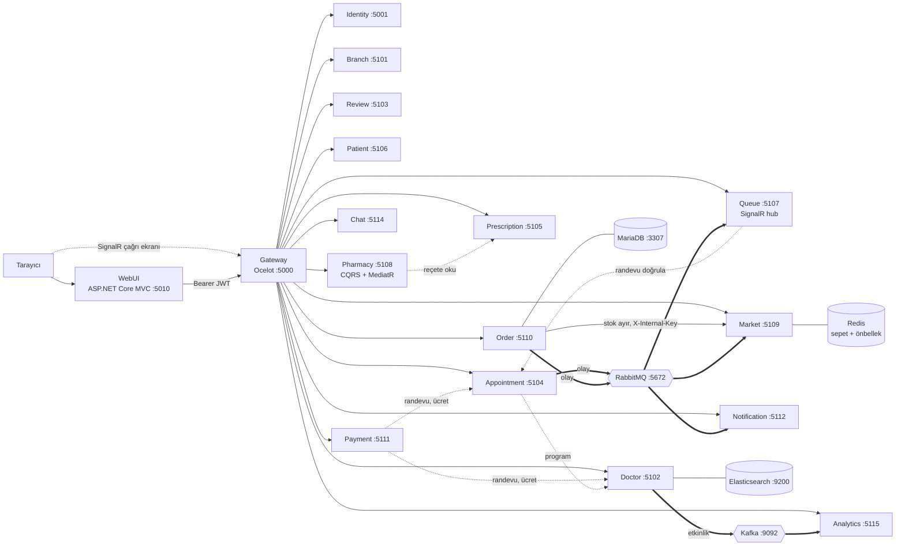

Her servisin **kendi veritabanı** vardır; bir servis başka bir servisin veritabanına bağlanmaz. Kullanıcının beklediği
işler (stok ayırma, randevu doğrulama, reçete okuma) **senkron HTTP** ile yapılır (kesikli oklar; kullanıcının token'ı ya da
iç anahtar iletilir). Kullanıcının beklemediği işler (bildirim, sıra kaydını kapatma, iptalde stok iadesi) **RabbitMQ**
olaylarıyla, analitik için ham etkinlik akışı **Kafka** ile taşınır (kalın oklar). Ayrıntı:
[`docs/OLAY-MIMARISI-RABBITMQ.md`](./docs/OLAY-MIMARISI-RABBITMQ.md).

| Servis | Port | Veri | Ne yapar |
|---|---|---|---|
| Gateway (Ocelot) | 5000 | — | Tek giriş kapısı, `/gateway/...` yollarını servislere yönlendirir; `/gateway/hubs/queue` WebSocket |
| Identity | 5001 | SQL Server | Kayıt, giriş, JWT (RS256), roller, şifre sıfırlama, doktor başvurusu, fotoğraf |
| WebUI (MVC) | 5010 | — | Arayüz; token'ı şifreli, HttpOnly çerezde tutar |
| Branch | 5101 | MongoDB | Branşlar |
| Doctor | 5102 | MongoDB (+ Elasticsearch, Kafka üretici) | Doktorlar, klinikler, ücret, haftalık program, arama ve öneri |
| Review | 5103 | MongoDB | Yorumlar, puan özeti, tavsiye oranı |
| Appointment | 5104 | SQL Server (+ outbox) | Randevular, boş saat hesabı, durum makinesi; randevu olaylarını yayınlar |
| Prescription | 5105 | SQL Server | Reçeteler ve kalemleri |
| Patient | 5106 | SQL Server | Hasta profili, favori doktorlar |
| Queue | 5107 | SQL Server + SignalR | Bekleme salonu sırası, günlük numara, çağrı ekranı yayını |
| Pharmacy | 5108 | SQL Server | İlaç kataloğu, stok defteri, reçete karşılama (CQRS + MediatR) |
| Market | 5109 | SQL Server + Redis | Ürünler, Redis'te ürün önbelleği ve sepet, atomik stok rezervasyonu |
| Order | 5110 | MariaDB (+ outbox) | Sipariş (kapıda ödeme), sipariş numarası, idempotency, iptal |
| Payment | 5111 | SQL Server | Ödeme, fatura, iade (sahte sağlayıcı) |
| Notification | 5112 | MongoDB + SMTP | Uygulama içi bildirim, e-posta; RabbitMQ olaylarını tüketir |
| Chat | 5114 | MongoDB | Hasta ↔ doktor mesajlaşma |
| Analytics | 5115 | MongoDB | Kafka'dan doktor etkinliklerini okur, günlük toplamlar |

Altyapı (`docker-compose.yml`): MongoDB `27017`, SQL Server `1433`, MariaDB `3307` (bilgisayardaki olası MySQL 3306 ile
çakışmasın), Redis `6379`, RabbitMQ `5672` / yönetim arayüzü `15672`, Seq (log paneli) `5341`, MailHog (sahte e-posta
kutusu) SMTP `1025` / arayüz `8025`. `extra` profilinde (ağır, isteğe bağlı): Elasticsearch `9200`, Kafka `9092`.
Elasticsearch ve Kafka kapalıyken servisler çalışmaya devam eder: doktor araması MongoDB'ye düşer, etkinlik akışı yazılmaz.

Kullanılan teknolojilerin tam listesi: [Teknoloji yığını](#teknoloji-yığını).

---

## Kurulum

### Gereksinimler

- [.NET SDK 10](https://dotnet.microsoft.com/download) (10.0.401 veya üstü; `global.json` sürümü sabitler)
- [Docker Desktop](https://www.docker.com/products/docker-desktop/) (çalışır durumda)
- PowerShell 7 (`pwsh`): kurulum ve başlatma betikleri için. Betikler **Windows'ta** denendi; macOS/Linux'ta
  [elle kurulum](#elle-kurulum-betik-kullanmadan) adımlarını izleyin ve servisleri `dotnet run --project <servis>` ile başlatın.
- En az ~8 GB RAM ve ~10 GB boş disk önerilir (SQL Server konteyneri ve testler). `-Extra` (Elasticsearch + Kafka) ~1,5 GB daha ister.

### Adım adım kurulum

1. **Gereksinimleri kurun** (yukarıdaki liste) ve Docker Desktop'ı açın.
2. **Depoyu indirin:**
   ```powershell
   git clone https://github.com/m0Corut/hospital-microservice.git
   cd hospital-microservice
   ```
3. **Kurulum betiğini çalıştırın** (bir kez). `.env` dosyasını oluşturur, veritabanı ve mesaj kuyruğu konteynerlerini açar,
   her servisin ayarını yazar, JWT anahtarı üretir ve çözümü derler:
   ```powershell
   pwsh -File scripts/setup-dev.ps1          # Elasticsearch + Kafka da istenirse: -Extra
   ```
4. **Uygulamaları başlatın** (15 servis + Gateway + arayüz, arka planda):
   ```powershell
   pwsh -File scripts/run-all.ps1
   ```
5. **Örnek veriyi yükleyin** (branşlar, 12 doktor, 6 hasta, randevular, reçeteler, yorumlar). Admin bilgileri `.env`
   dosyasındaki `ADMIN_EMAIL` / `ADMIN_PASSWORD`; varsayılanlar aşağıdaki gibidir:
   ```powershell
   dotnet run --project tools/Hastane.DevSeed -- --admin-email admin@hastane.local --admin-password Admin12345!
   ```
6. Tarayıcıda **http://localhost:5010** adresini açın ve [demo hesaplarından](#demo-hesapları) biriyle giriş yapın.

İlk kurulum, Docker imajlarının indirilmesi yüzünden internet hızına göre 5–15 dakika sürebilir; sonraki açılışlarda yalnız
4. adım yeterlidir (Docker Desktop açıkken).

`-Extra` altyapıyı `extra` profiliyle açar ve Doctor ile Analytics'e Elasticsearch/Kafka adreslerini yazar.

| Adres | Ne |
|---|---|
| http://localhost:5010 | Uygulama |
| http://localhost:5010/Queue/Display | Bekleme salonu çağrı ekranı (girişsiz) |
| http://localhost:8025 | MailHog: "şifremi unuttum" e-postaları buraya düşer |
| http://localhost:15672 | RabbitMQ yönetim arayüzü (kullanıcı/parola `.env` → `RABBITMQ_USER` / `RABBITMQ_PASSWORD`) |
| http://localhost:5341 | Seq log paneli |
| http://localhost:5000/health | Gateway sağlık kontrolü |

Servisleri durdurmak: `pwsh -File scripts/run-all.ps1 -Stop`. Altyapıyı durdurmak: `docker compose down`
(`extra` profiliyle açtıysanız `docker compose --profile extra down`).

### Kurulum betiği ne yapıyor?

`scripts/setup-dev.ps1`:

1. `.env` yoksa `.env.example`'dan oluşturur. Veritabanı şifreleri ve ilk yönetici hesabı buradan gelir.
   **Yayına açık bir ortamda bu değerleri mutlaka değiştirin.**
2. `docker compose up -d` ile altyapıyı açar (MongoDB, SQL Server, MariaDB, Redis, RabbitMQ, Seq, MailHog);
   `-Extra` ile Elasticsearch ve Kafka da.
3. Her servisin [user-secrets](https://learn.microsoft.com/aspnet/core/security/app-secrets)'ına şunları yazar:
   bağlantı cümleleri (SQL Server, MongoDB, MariaDB, Redis), RabbitMQ bağlantısı (olay yayınlayan/tüketen servisler),
   servisler arası iç anahtar (`Internal:ApiKey`; Identity, Notification, Market, Order aynı değer), ilk Admin bilgisi;
   `-Extra` ile Doctor'a `Elasticsearch:Url` ve `Kafka:BootstrapServers`, Analytics'e `Kafka:BootstrapServers`.
   Sırlar depoya girmez, ekrana basılmaz; mevcut değerlere dokunmaz (`-Force` ile üzerine yazar). `-DryRun` ile yalnız ne
   yapacağını gösterir.
4. Identity'de JWT özel anahtarı yoksa yeni bir RSA anahtar çifti üretir (`scripts/new-jwt-keys.ps1`). Özel anahtar
   yalnız sizin bilgisayarınızda (user-secrets) kalır; açık anahtar `src/Shared/Hastane.Shared/jwt-public.pem` dosyasına
   yazılır. Bu dosya değişince commit etmeniz gerekmez.
5. Çözümü derler.

Veritabanı tabloları servisler ilk açıldığında (Development ortamında) EF Core migration'larıyla kendiliğinden kurulur.
Market, geliştirmede mağaza boş görünmesin diye tablo boşsa 10 örnek ürün yükler.

### Elle kurulum (betik kullanmadan)

<details>
<summary>Adımlar</summary>

```powershell
cp .env.example .env                 # değerleri düzenleyin
docker compose up -d                 # Elasticsearch + Kafka da isteniyorsa: docker compose --profile extra up -d
pwsh -File scripts/new-jwt-keys.ps1 -Force

# SQL Server servisleri (şifre .env'deki SQL_SA_PASSWORD)
dotnet user-secrets set "ConnectionStrings:IdentityDb" "Server=localhost,1433;Database=hastane_identity;User Id=sa;Password=<şifre>;TrustServerCertificate=True" --project src/Services/Identity/Hastane.Identity.Api
# Appointment, Prescription, Payment, Patient, Queue, Pharmacy, Market: anahtar "ConnectionStrings:DefaultConnection", veritabanı hastane_<servis>

# MongoDB servisleri: Branch, Doctor, Review, Notification, Chat, Analytics
dotnet user-secrets set "DatabaseSettings:ConnectionString" "mongodb://<MONGO_USER>:<MONGO_PASSWORD>@localhost:27017/?authSource=admin" --project src/Services/Branch/Hastane.Branch.Api

# Order (MariaDB, port 3307) ve Market (Redis)
dotnet user-secrets set "ConnectionStrings:DefaultConnection" "Server=localhost;Port=3307;Database=hastane_order;User=root;Password=<MARIADB_ROOT_PASSWORD>" --project src/Services/Order/Hastane.Order.Api
dotnet user-secrets set "ConnectionStrings:Redis" "localhost:6379,password=<REDIS_PASSWORD>" --project src/Services/Market/Hastane.Market.Api

# RabbitMQ: Appointment, Notification, Order, Market, Queue (boş kalırsa servis bellek içi taşımaya düşer, olaylar servisler arası akmaz)
dotnet user-secrets set "RabbitMq:Host" "localhost" --project src/Services/Appointment/Hastane.Appointment.Api
dotnet user-secrets set "RabbitMq:Username" "<RABBITMQ_USER>" --project src/Services/Appointment/Hastane.Appointment.Api
dotnet user-secrets set "RabbitMq:Password" "<RABBITMQ_PASSWORD>" --project src/Services/Appointment/Hastane.Appointment.Api

# İsteğe bağlı (extra profili): Doctor'a Elasticsearch:Url=http://localhost:9200 ve Kafka:BootstrapServers=localhost:9092,
# Analytics'e Kafka:BootstrapServers=localhost:9092

# Identity, Notification, Market ve Order'a AYNI rastgele değer
dotnet user-secrets set "Internal:ApiKey" "<rastgele-uzun-değer>" --project src/Services/Identity/Hastane.Identity.Api

# İlk Admin (yalnız sistemde hiç Admin yoksa oluşturulur)
dotnet user-secrets set "Seed:AdminEmail" "admin@hastane.local" --project src/Services/Identity/Hastane.Identity.Api
dotnet user-secrets set "Seed:AdminPassword" "<şifre>" --project src/Services/Identity/Hastane.Identity.Api

dotnet build HastaneMikroservis.slnx
```
</details>

### Sık karşılaşılanlar

- **`docker compose` hata veriyor:** Docker Desktop açık mı? `docker ps` çalışmalı.
- **Bir servis açılmıyor:** `logs/<Servis>.err.log` dosyasına bakın; çoğunlukla eksik user-secrets ya da kapalı veritabanıdır.
  `pwsh -File scripts/setup-dev.ps1 -DryRun` eksikleri gösterir.
- **Bildirim gelmiyor / sıra kaydı iptalde kapanmıyor:** RabbitMQ açık mı, servislerde `RabbitMq:Host` dolu mu? Boşsa
  olaylar yalnız aynı süreç içinde kalır. Hatalı mesajlar RabbitMQ arayüzünde `<kuyruk>_error` kuyruğunda görünür.
- **Sepet 503 veriyor:** Redis kapalı ya da `ConnectionStrings:Redis` yanlış. Ürün listesi yine çalışır (önbelleksiz).
- **Testler toplu başarısız:** Docker belleği yetmiyor olabilir (her test sınıfı geçici bir veritabanı konteyneri açar). Docker'a
  en az 4 GB bellek verin, test projelerini tek tek koşun.

---

## Docker ile tam sistem

Geliştirmede servisler `dotnet run` ile, yalnız altyapı Docker'da çalışır. Tüm sistemi (altyapı + 15 servis + Gateway +
WebUI) konteynerde açmak için:

```powershell
pwsh -File scripts/docker-up.ps1            # .env + secrets/ üretir, imajları derler, hepsini başlatır
pwsh -File scripts/docker-up.ps1 -Seed      # + örnek veri
pwsh -File scripts/docker-up.ps1 -Extra     # + Elasticsearch, Kafka, Analytics
pwsh -File scripts/docker-up.ps1 -Proxy     # + Caddy (80/443, otomatik HTTPS; .env'de DOMAIN gerekir)
```

- **Tek, parametrik `Dockerfile`** (depo kökünde): çok aşamalı (SDK ile derle, yalnız ASP.NET çalışma zamanı ile çalıştır),
  root olmayan kullanıcı (`app`), port 8080. `docker-compose.full.yml` her servis için proje yolunu argüman olarak verir.
- **`docker-compose.full.yml`** `docker-compose.yml`'in üstüne biner: servisler birbirine konteyner adıyla ulaşır
  (`http://identity:8080`), servis portları dışarı açılmaz, yalnız Gateway ve WebUI (varsayılan 127.0.0.1) yayımlanır.
- **`ocelot.Docker.json`**: Gateway'in konteyner adresli rota dosyası; `ocelot.json`'dan `scripts/sync-ocelot-docker.ps1`
  ile üretilir (Gateway testleri iki dosyanın aynı rota setine sahip olduğunu denetler).
- **`Database:MigrateOnStartup`**: Development dışında (Docker) migration'ları açılışta uygulatır.
- **JWT anahtarları** `secrets/` klasöründe dosya olarak durur (`docker-up.ps1` üretir, gitignore'da); compose onları
  konteynere dosya yolu olarak verir.
- **Caddy** (`deploy/Caddyfile`): yalnız WebUI'yi ve SignalR yolunu (`/gateway/hubs/*`) internete açar.

Bir VPS'e adım adım kurulum, yedekleme ve güncelleme: [`docs/YAYINLAMA.md`](./docs/YAYINLAMA.md).

> Geliştirme servisleri (`run-all.ps1`) ile Docker sistemini aynı anda çalıştırmayın: 5000, 5010 ve altyapı portları çakışır.

---

## Demo hesapları

Örnek veri aracı (`tools/Hastane.DevSeed`) çalıştırıldıktan sonra:

| Rol | E-posta | Şifre |
|---|---|---|
| Yönetici | `admin@hastane.local` (`.env` → `ADMIN_EMAIL`) | `.env` → `ADMIN_PASSWORD` (varsayılan `Admin12345!`) |
| Doktor | `dr.ahmet.yilmaz@hastane.local` | `Hastane123!` |
| Hasta | `hasta1@hastane.local` … `hasta6@hastane.local` | `Hastane123!` |

12 doktorun hepsi `dr.<ad>.<soyad>@hastane.local` biçimindedir (araç sonunda listeyi yazdırır). Örnek veri: 8 branş,
12 doktor (avatar, klinik görselleri, ücret, haftalık program), 6 hasta, 15 randevu (farklı durumlarda), ödemeler,
reçeteler ve yorumlar. Araç tekrar çalıştırılınca kopya üretmez. Mağaza ürünleri Market servisi tarafından yüklenir
(Development'ta, tablo boşsa).

Ödeme sayfasında test kartı `4242 4242 4242 4242` (herhangi bir gelecek tarih ve CVV) kabul edilir; `4000 0000 0000 0002`
reddedilir. Gerçek ödeme yoktur. Mağaza siparişleri kapıda ödemelidir.

> Bu hesaplar yalnız yerel geliştirme içindir. Şifreleri herkese açık bir sunucuda kullanmayın.

---

## Testler

```powershell
dotnet test --project tests/Hastane.Appointment.Tests      # tek proje
```

Tüm projeleri sırayla koşmak (Docker açık olmalı; entegrasyon testleri geçici veritabanı konteynerleri açar):

```powershell
Get-ChildItem tests -Directory -Filter "Hastane.*.Tests" | ForEach-Object { dotnet test --project $_.FullName }
```

<!-- TEST-SAYILARI: 2026-10-10, 18 proje sırayla, hepsi geçti -->
| Proje | Test | Proje | Test |
|---|---|---|---|
| WebUI | 884 | Market | 157 |
| Doctor | 196 | Pharmacy | 144 |
| Identity | 196 | Patient | 138 |
| Payment | 190 | Notification | 133 |
| Appointment | 184 | Order | 112 |
| Gateway | 111 | Queue | 97 |
| Review | 63 | Analytics | 57 |
| Prescription | 56 | Chat | 49 |
| Branch | 35 | Shared | 35 |
| | | **Toplam** | **2.837** |

Testler mock veritabanı kullanmaz: MongoDB, SQL Server, MariaDB ve Redis'e karşı gerçek konteynerlerle çalışır. Olay
tüketicileri MassTransit test düzeneğiyle (bellek içi taşıma) denenir. Arayüz testleri gerçek bir Kestrel üzerinde sahte bir
Gateway ile koşar. Her serviste her uç noktanın yetki etiketini denetleyen bir "yetki tablosu" testi vardır; etiketi
unutulan uç test aşamasında yakalanır.

---

## Güvenlik tasarımı

- **JWT RS256:** yalnız Identity özel anahtarı bilir; servisler gömülü açık anahtarla doğrular. Algoritma yalnız RS256,
  `alg:none` ve HS256 ile yeniden imzalanmış token'lar reddedilir (testli). Token ömrü 30 dk.
- **Tarayıcıda token yok:** WebUI token'ı doğrulayıp şifreli, HttpOnly, SameSite=Lax bir çereze koyar; API çağrılarında
  sunucu tarafında `Authorization` başlığına ekler. Tüm formlarda antiforgery, çıkış POST ile.
- **Yetki iki katmanlı:** rol kontrolü uç noktada, sahiplik kontrolü serviste (hasta başkasının randevusunu göremez; başkasının
  kaydı 404 döner, varlığını sızdırmaz). Kimlik (`PatientId`, `ReviewerId`, sepet anahtarı …) istekten değil token'dan alınır.
- **Para ve stok:** tutar ve fiyat sunucuda yeniden okunur (sepetteki fiyata güvenilmez), idempotency anahtarı çift
  çekimi ve çift siparişi engeller, stok tek bir koşullu `UPDATE` ile düşer (eksiye inemez), kart numarası saklanmaz.
- **Herkese açık çağrı ekranı:** SignalR hub'ı anonim ama yalnız dinleme sunar; yayında yalnız sıra numarası ve maskeli ad
  ("Can Y.") var, hasta/randevu kimliği yok.
- **Hesap:** kullanıcı numaralandırmaya karşı aynı yanıtlar, hesap kilidi, şifre sıfırlamada hız sınırı, son Admin koruması.
- **Dosya yükleme:** tür içerikten (magic bytes) belirlenir, SVG reddedilir, dosya adı sunucu üretir, `nosniff` + CSP.
- **Servisler arası:** iç uçlar (ör. Market stok rezervasyonu) ortak bir anahtarla (`X-Internal-Key`, sabit zamanlı
  karşılaştırma) korunur ve Gateway'den dışarı açılmaz. Sırlar depoda değil, user-secrets / `.env` / `secrets/`'ta.
- **Olaylarda kişisel veri yok:** RabbitMQ ve Kafka olayları yalnız kimlik ve tarih taşır; ad, telefon, tanı taşımaz.
- **Docker:** root olmayan kullanıcı, servis portları dışarı kapalı, altyapı portları varsayılan 127.0.0.1.

**Bilinen sınırlar:** token iptali (çıkışta token'ın geçersizleşmesi) yok, refresh token yok, rate limit yalnız şifre
sıfırlamada. Ayrıntı: [`KOD-HARITASI.md`](./KOD-HARITASI.md) ve [`JWT-TASARIM.md`](./JWT-TASARIM.md).

---

## Kurstan bilinçli sapmalar

| Konu | Kurs (büyük olasılıkla) | Bu depo | Neden |
|---|---|---|---|
| JWT imzası | HS256, ortak parola | RS256, açık/özel anahtar | Ortak parolayı bilen her servis token basabilirdi; burada yalnız Identity basar. |
| Nesne eşleme | AutoMapper | Mapster | AutoMapper'ın güncel sürümünde bilinen bir güvenlik açığı ve ticari lisans değişikliği. |
| Token'ın yeri | Tarayıcı / oturum | Şifreli HttpOnly çerez | XSS ile token çalınmasın. |
| Mesajlaşma | SignalR | Kısa aralıklı sorgulama | SignalR tarayıcıda token ister; burada token bilerek tarayıcıya verilmez. SignalR, sıra ekranında (anonim, yalnız dinleme) kullanıldı. |
| Gateway | Kimlik doğrulama Gateway'de | Gateway iletir, servisler doğrular | Servise doğrudan gelen istek de korumasız kalmasın. |
| Veritabanı kurulumu | Portainer'dan tek tek | Tek `docker-compose.yml` | Tek komutla kurulum. |
| Servisler arası | Senkron HTTP | Kullanıcının beklemediği işler RabbitMQ olayı (outbox), stok rezervasyonu bilerek senkron | Bildirim servisi çökse de randevu/sipariş kaydı ve olay kaybolmasın. |
| MariaDB sağlayıcısı | Pomelo (büyük olasılıkla) | Oracle `MySql.EntityFrameworkCore` | Pomelo'nun EF Core 10 için kararlı sürümü yok (yalnız önizleme). |
| Elasticsearch | 2 teorik ders | Doktor aramasında gerçek kullanım | Kursta yalnız teori; biz Türkçe analiz ve yedek yolla uyguladık. |


---

## Proje notları: nereden okunur?

Bu depo bir öğrenme projesi olduğu için kodun yanında ayrıntılı Türkçe notlar tutuldu:

| Dosya | İçerik |
|---|---|
| [`OGRENME-NOTLARI.md`](./OGRENME-NOTLARI.md) | Kavram anlatımları: her konu "tek cümle → benzetme → olmasa ne olurdu → kodda nerede" düzeninde (DTO, DI, migration, transaction, JWT, CSRF, idempotency, SignalR, CQRS, Redis, Elasticsearch, Kafka, outbox, Docker …) |
| [`KOD-HARITASI.md`](./KOD-HARITASI.md) | Kodun haritası: klasörler, `Program.cs` kayıtları, her uç nokta için istek yolu (`dosya:satır`), veritabanı komutu karşılığı, checkout gibi çok servisli akışlar adım adım |
| [`docs/OLAY-MIMARISI-RABBITMQ.md`](./docs/OLAY-MIMARISI-RABBITMQ.md) | Hangi olay kimden kime gider, outbox, yeniden deneme, hata kuyrukları, RabbitMQ arayüzü |
| [`docs/YAYINLAMA.md`](./docs/YAYINLAMA.md) | Tüm sistemi Docker ile bir VPS'te çalıştırma, yedekleme, güncelleme |
| [`docs/HOCA-KARSILASTIRMA.md`](./docs/HOCA-KARSILASTIRMA.md) | Hocanın deposu ile bu deponun karşılaştırması |
| [`JWT-TASARIM.md`](./JWT-TASARIM.md) | Kimlik ve yetki tasarımı, uç nokta bazında yetki matrisi |
| [`src/WebUI/Hastane.WebUI/UI-KURALLARI.md`](./src/WebUI/Hastane.WebUI/UI-KURALLARI.md) | Arayüze yeni ekran ekleme kuralları |

---


## Yol haritası

**Tamamlananlar:** kursun B1–B21 bölümlerinin tamamı (branş, doktor, yorum, randevu, kimlik, reçete, arayüz, JWT ve yetki,
Ocelot, hasta, sıra + SignalR, eczane, Redis ile ürün ve sepet, MariaDB ile sipariş, Elasticsearch) + yukarıdaki eklemeler:
RabbitMQ ile olay tabanlı iletişim (outbox), Kafka ile etkinlik akışı ve analitik, Dockerfile'lar ve tek komutla yayın.

**Fikirler:** tıbbi kayıtlar (dosya + KVKK erişim kaydı, port 5113 ayrıldı), refresh token, sağlık kontrolleri ve merkezi
log her serviste, GitHub Actions CI, randevu hatırlatma (zamanlanmış iş), sıra ekranında bekleme süresi tahmini.

---

## Atıf ve lisans

- **Kurs:** Murat Yücedağ, [ASP.NET Core Mikroservis Mimarisi | Doccure Hastane Sistemi](https://www.udemy.com/course/aspnet-core-mikroservis-mimarisi-doccure-hastane-sistemi/) (Udemy).
  Bu depo kursun resmi kodu değildir ve kursla bağlantılı bir yayın değildir.
- **Tasarım esini:** Doccure (ticari bir Bootstrap teması). Temanın HTML/CSS/görselleri kullanılmadı; arayüz Bootstrap 5
  ile yeniden yazıldı, görseller bu proje için çizildi.
- **Kullanılan açık kaynaklar:** Bootstrap, Bootstrap Icons, Chart.js (MIT), Ocelot, Mapster, MailKit, StackExchange.Redis
  (MIT), Elastic.Clients.Elasticsearch, Confluent.Kafka (Apache-2.0), SignalR JS istemcisi, Testcontainers ve diğer NuGet
  paketleri (`Directory.Packages.props`).
- **Lisansa göre seçilen sürümler** (gerekçeler `Directory.Packages.props` yorumlarında):
  - **MediatR 12.5.0**: son Apache-2.0 sürüm; 13.0 ve sonrası ticari lisans anahtarı ister.
  - **MassTransit 8.5.11** (+ RabbitMQ, EntityFrameworkCore): 8.x çizgisi Apache-2.0; 9.x ticari lisansa geçti, kullanılmaz.
  - **MySql.EntityFrameworkCore 10.0.9** (Oracle, Order servisi): GPLv2 + Universal FOSS Exception. Açık kaynak bir projede
    kullanım bu istisnayla serbest; projeyi kapalı kaynak dağıtacaksanız lisansı ayrıca değerlendirin.
- **Lisans:** henüz belirlenmedi.
